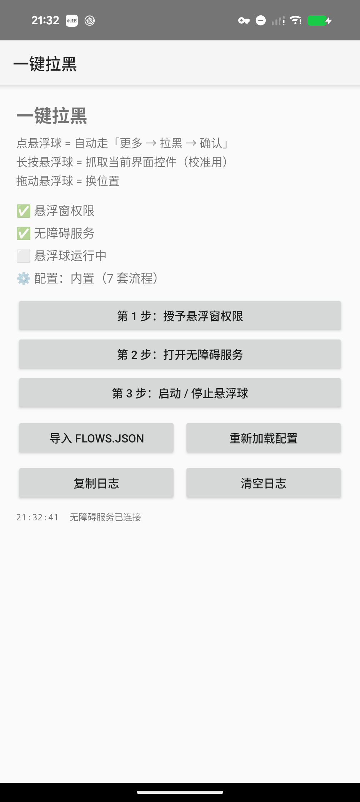

# 一键拉黑（Android）

屏幕上一个悬浮球：**点一下**，自动把当前正在看的那个账号拉黑（屏蔽）。支持 X、B站、抖音。

版本 v2.7 · minSdk 26 / targetSdk 34 · debug 签名（仓库里不放大文件，APK 自己编一下即可，见「6.1 编译」）。

[](https://github.com/XU-DONGYU/onekey-block/actions/workflows/build.yml) [](LICENSE)

---


## 1. 介绍

### 三个手势

| 手势 | 作用 |
|---|---|
| **单击**悬浮球 | 执行拉黑流程 |
| **长按**悬浮球 | 抓取当前界面的控件树（打到日志 + 复制到剪贴板），用来校准选择器 |
| **拖动**悬浮球 | 换位置（会被夹在屏幕内，拖不出去） |

球会变色表示状态：执行中 **蓝**、成功 **绿**、失败 **红**。

### 屏幕左边那个箭头（X 专有）

X 的时间线一屏能塞三四条帖子，「拉黑的是哪一条」是有歧义的，所以单独做了个指示器。

屏幕左边缘一个红色小箭头，**尖端顶在即将被拉黑那个账号的头像下沿**。规则和点击逻辑同源：屏幕垂直中线落在哪条帖子里，箭头就指到那条帖子的作者。滚动时每 0.5 秒重算一次，只画不点（`FLAG_NOT_TOUCHABLE`），不会挡住滑屏。

B站、抖音 一屏只有一条内容，本来就没有歧义，所以**不显示箭头**。


### 拉黑完会回到原页面

抖音、B站 的流程最后都带一步 `back`：从视频页进主页拉黑，自动退回视频页；直播间同理。X 的拉黑是在当前页面弹窗完成的，本来就不会跳走。

失败时（球变红）流程就地停住，不会盲目按返回。

## 2. 支持的软件

| 软件 | 包名 | 备注 |
|---|---|---|
| X（Twitter） | `com.twitter.android` | 一屏多条帖子，取「屏幕中间那条」 |
| B站 | `tv.danmaku.bili` | 普通视频页 + 竖屏视频流，两套流程 |
| 抖音 | `com.ss.android.ugc.aweme` | 控件树几千节点，最慢；视频页和直播间两套流程 |
| 其他 App | — | 球变红并提示「没有适配 <包名>」 |

## 3. 支持的页面

按**当前前台 App + 当前界面特征**自动选流程，不需要你手动切换模式。

| 软件 | 从哪个页面点球 | 实际走的路径 | 状态 |
|---|---|---|---|
| **X** | 时间线 / 帖子页 / 带视频的帖子 | `发帖选项` → `屏蔽 @用户` → `屏蔽` | ✅ 实测 |
| X | 别人主页 | 右上角 `更多选项` → `屏蔽 @用户` → `屏蔽` | ✅ 实测 |
| X | 全屏视频播放器 | `@用户名` → 主页 → `更多选项` → `屏蔽 @用户` → `屏蔽` → 返回 | ✅ 节点点击 |
| X | 全屏视频（控制条隐藏时） | 同上，`reveal` 会先点一下屏幕把控制条唤出来 | ⚠️ 偶发需再点一次 |
| **B站** | 普通视频播放页 | `UP主那一行` → 进空间 → `⋯` → `加入黑名单` → `确认` → 返回 | ✅ 实测到确认弹窗 |
| B站 | 竖屏视频流（上下滑） | `UP主头像` → 卡片 `进入空间` → `⋯` → `加入黑名单` → `确认` → 返回 | ✅ 实测 |
| B站 | UP主空间页（已在里面） | 自动跳过第一步 → `⋯` → `加入黑名单` → `确认` | ✅ 同上 |
| B站 | 首页信息流 | ❌ 卡片上的 UP 名没有稳定标识 | — |
| B站 | 直播间 | ❌ 暂未适配 | — |
| **抖音** | 推荐页 / 视频页 | 左下角 `@作者` → 主页 → `更多` → `拉黑` → `确认拉黑` → 返回 | ✅ 实测到确认弹窗 |
| 抖音 | 作者主页（已在里面） | 自动跳过第一步 → `更多` → `拉黑` → `确认拉黑` | ✅ 同上 |
| 抖音 | 直播间（点进全屏） | 左上角主播名 → 资料卡点名字 → 主页 → `更多` → `拉黑` → `确认拉黑` → 返回 | ✅ 实测到确认弹窗 |
| 抖音 | 直播预览（直播 tab 未点进去） | 左下角 `@主播` → 主页 → 同上 | ✅ 同上 |

### 耗时

| App | 一次完整流程 |
|---|---|
| X | **1.1 秒** |
| B站 | 6~8 秒 |
| 抖音 | **3~4 秒**（v2.3 起把「更多」改成坐标点击） |

慢的是这几个 App 自己吐控件树的速度，不是点击。原因见下一节。

## 4. 项目结构

### 4.1 目录

```text
onekey-block/
├── app/                          安卓应用模块，所有代码都在这
│   ├── src/main/
│   │   ├── java/com/oneblock/    8 个 Java 文件（见 4.2）
│   │   ├── assets/
│   │   │   └── flows.json        ★ 核心配置：每个 App 怎么点
│   │   ├── res/
│   │   │   ├── layout/           主界面布局
│   │   │   ├── drawable/         卡片、按钮的背景样式
│   │   │   ├── values/           颜色（设计 token）、字符串
│   │   │   └── xml/              无障碍服务的配置
│   │   └── AndroidManifest.xml   权限、服务、Activity 声明
│   └── build.gradle              版本号、SDK 版本、依赖
├── .github/workflows/
│   ├── build.yml                 日常构建 + 版本号变了自动发 Release
│   └── release.yml               打 v* tag 时构建并发 Release
├── docs_marker.png               箭头截图（README 用）
├── docs_status.png               主界面截图（README 用）
├── dist/                         本地打出来的 APK，已 .gitignore，不入库
├── gradle/wrapper/               固定 Gradle 8.7
├── gradlew / gradlew.bat         构建入口（macOS/Linux 用前者，Windows 用后者）
├── build.gradle / settings.gradle  项目级 Gradle 配置
├── LICENSE                       MIT
└── README.md                     就是这份
```

### 4.2 关键文件

| 文件 | 干什么 | 什么时候会改它 |
|---|---|---|
| `assets/flows.json` | **全部行为都在这里**：7 套流程，每套是「找什么 → 点什么 → 等多久 → 失败怎么办」 | 换选择器、加新 App。**90% 的改动都在这一个文件** |
| `FlowEngine.java` | **流程引擎**：按步骤执行，负责找控件、点击、等待、重试、超时看门狗 | 加新的 action 类型、改执行策略 |
| `Flow.java` | 把 `flows.json` 解析成对象；三层配置加载（外部文件 > 已导入 > 内置） | 加配置字段 |
| `OverlayService.java` | 悬浮球 + 左侧箭头两个浮窗：显示、拖动、变色、箭头定位 | 改悬浮球的外观和行为 |
| `BlockAccessibilityService.java` | 无障碍服务：读当前界面控件树、点节点、模拟手势 | 改底层「怎么点」 |
| `UiUtil.java` | 控件树工具：遍历、按文字/描述匹配、取屏幕中间那条、算坐标 | 改匹配规则 |
| `MainActivity.java` | 主界面：三步授权、导入/重载配置、看日志 | 改 App 外壳 |
| `ArrowView.java` | 左侧那个箭头的自绘 View | 改箭头形状/颜色 |
| `Logx.java` | 环形日志缓冲，App 内展示 + 长按复制 | 基本不用动 |
| `res/values/colors.xml` | 设计 token：主色 `#3B82F6`、成功绿、危险红、灰阶 | 换配色 |
| `.github/workflows/*.yml` | CI：构建 APK、发 Release | 改自动化流程 |

### 4.3 想改点什么，去哪改

| 我想… | 改哪里 | 要重新编译吗 |
|---|---|---|
| 换某个 App 的选择器 | `assets/flows.json` | **不用**，手机里导入或 `adb push` 后点「重新加载」（见 6.4） |
| 加一个新 App | 同上，加一套 flow | 同上 |
| 改悬浮球颜色 / 大小 | `OverlayService.java` | 要 |
| 改箭头形状 | `ArrowView.java` | 要 |
| 改主界面 | `res/layout/activity_main.xml` + `res/values/colors.xml` | 要 |
| 改版本号 | `app/build.gradle` 的 `versionName` / `versionCode` | 要（推上去会自动发 Release） |
| 改 CI | `.github/workflows/` | 不用 |
## 5. 技术路线

### 5.1 三层结构

```
OverlayService（前台服务）
 ├─ 悬浮球窗口 + 左侧箭头窗口（TYPE_APPLICATION_OVERLAY）
 └─ 每 500ms 算一次「这一下会打谁」，只更新箭头

BlockAccessibilityService（无障碍服务）
 ├─ 读当前窗口控件树（getRootInActiveWindow）
 ├─ 点控件（performAction 或按坐标点中心）
 └─ 手势点击（dispatchGesture）

FlowEngine（流程引擎）
 └─ 按 assets/flows.json 的步骤逐条执行
```

**流程是配置驱动的**：加一个新 App、改一句选择器，只改 `flows.json`，不用动 Java。

### 5.2 一条流程怎么跑

- 每步默认**每 60ms 扫一次控件树**，目标一出现就点，不再「点完死等 900ms」——X 上因此从 2.4 秒降到 1.1 秒。
- 但要求**连续两次位置完全一致**才动手，避开菜单/弹窗还在动画的时候。
- 支持 `click` / `wait` / `back` / `gesture`（相对坐标）/ `dump` 五种动作。

### 5.3 踩过的坑与解法

| 问题 | 解法 |
|---|---|
| X 一屏好几条帖子，点哪条？ | `pick: center` —— 取「顶部不超过屏幕中线」中最靠下的「发帖选项」。因为该按钮就在帖子头部，等价于选出**屏幕中线正落在那条帖子里** |
| 抖音控件树几千节点，扫一次 3~7 秒 | `find` 字段：先让系统级 `findAccessibilityNodeInfosByText` 搜一遍（一次 IPC），再用正则过滤。文字步骤降到 ~270ms |
| 同一 App 多个入口（抖音视频页 / 直播间） | 流程级 `detect`：只有当前界面命中特征才用这套流程，没写 `detect` 的那套当兜底 |
| 播放器控制条自动隐藏，找不到按钮 | `reveal`：某步找不到控件时，先点一下屏幕正中把它唤出来再重试（已在显示状态就不会多点） |
| 点了没反应，但 `performAction` 返回成功 | 原来「信任可点击祖先」是坑（B站黑名单确认按钮就是祖先 `clickable=true` 但不响应）。改成：控件自己能点才 `performAction`，否则**按坐标点它的中心** |
| 箭头总比目标低 113px | 浮窗没加 `FLAG_LAYOUT_IN_SCREEN` 时坐标相对内容区（不含状态栏）。加上即可 |
| 悬浮球被拖出屏幕，之后怎么点都没反应 | 拖动时把 `x/y` 夹在屏幕范围内 |
| 抖音偶发卡住，之后一直提示「上一步还没跑完」 | 某次跨进程调用卡死导致 `running` 永不归位。加 90 秒看门狗 + 轮次号，超时强制放行 |
| 用记事本改 `flows.json` 后解析失败 | PowerShell/记事本会写 UTF-8 BOM，代码里已自动吃掉 |

### 5.4 实测到的关键控件

中文版各 App 的按钮命名和直觉不一样，这些是实打实 dump 出来的：

| App | 控件 | 实际值 |
|---|---|---|
| X | 帖子右上角「更多」 | 无障碍描述 = **发帖选项**（不是「更多」） |
| X | 别人主页右上角 | 无障碍描述 = **更多选项** |
| X | 菜单项 / 确认按钮 | **屏蔽 @用户名** / **屏蔽** |
| B站 | 普通视频页的 UP 主行 | 描述 = **up主<昵称>，…，点击进入空间页** |
| B站 | 竖屏页的 UP 主头像 | 描述 = **UP主头像** |
| B站 | 空间页右上角 ⋯ | **没有文字也没有描述**，只能按相对坐标 `(0.944, 0.069)` |
| 抖音 | 左下角作者 | 文字 = `@昵称` |
| 抖音 | 主页右上角 | 描述 = **更多** |
| 抖音 | 菜单项 / 确认 | **拉黑** / **确认拉黑** |
| 抖音 | 直播间判断 | 底部输入框 **说点什么…**；主播按钮描述以 **本场点赞** 结尾 |

广告条的「⋯」不是「发帖选项」，本来就匹配不上，会自然跳过。

### 5.4.5 稳定性：坐标点击的三道保险

纯坐标点击是最脆的一环（页面没加载完就点，等于白点，还可能点到旁边的「搜索」按钮上）。v2.6 加了三条规则：

**1. 点坐标前先确认页面对了**

```json
{ "action": "waitFor", "by": "text", "pattern": "获赞", "find": "获赞", "timeoutMs": 3000 },
{ "action": "wait", "ms": 400 },
```

抖音视频页和作者主页长得像，但只有主页有「获赞」。等不到就不往下面走，直接算失败重试——绝不在错误的页面上乱点。

**2. 点完要验货，不行就再点**

```json
{ "action": "gesture", "x": 0.929, "y": 0.093,
  "by": "text", "pattern": "^拉黑$", "find": "拉黑",
  "timeoutMs": 1800, "tries": 3 }
```

坐标点下去后等「拉黑」出现，1.8 秒没出来就再点一次，最多 3 次。页面渲染慢半拍不再等于失败。

**3. 点之前先等界面停下来**

``````json
{ "action": "settle", "by": "text", "pattern": "^@[^\\s]+$", "find": "@", "timeoutMs": 1500 }
``````

连续两次采样拿到同一个作者名才算稳定。所以**刷着视频随手点球也行**，不用先停下来等画面静止——刚划完就点也不会点在上一帧的控件上。

**4. 整套流程失败会重来**

流程级 `"attempts": 3`：失败后从第一步重跑，最多三次。重试前**只在自家面板还开着时才按返回**（`resetFind`），绝不盲按——否则一次失败可能把人踢出 App，下一次尝试直接废掉。

**实测**：同一台手机连点 14 次，其中一半是「刚划完视频立刻点球」（模拟随手操作），**14 次全部成功**，单次 5~7 秒。
### 5.5 哪几处只能按坐标点

| 位置 | 相对坐标 | 为什么不能点控件 |
|---|---|---|
| B站 空间页右上角 `⋯` | (0.944, 0.069) | 纯图标按钮，text 和 contentDescription 都是空的 |
| 抖音直播间 左上角主播信息条 | (0.197, 0.094) | 描述每个房间都不一样（`…本场点赞` / `…认证标签`），没法写正则 |
| 抖音直播间 资料卡里的主播名 | (0.168, 0.672) | 卡片高度随内容变，名字节点自身也没有可用描述 |
| 抖音 作者主页右上角 `更多` | (0.929, 0.093) | 原来是按描述找，全量扫一次 2.7 秒；换成坐标后 ~20ms |

坐标点击本身**几乎不耗时**（一次手势 ~60ms），真正贵的是读控件树：

| 动作 | 耗时 |
|---|---|
| 坐标点击 `gesture` | ~60ms |
| 系统级文字搜索 `find` | ~270ms |
| 全量遍历控件树（按描述找，抖音约 500 个节点） | 2.5~3 秒 |

抖音的「更多」是 **contentDescription**，系统没有按描述搜索的 API，只能全量扫——这就是它原来慢的主因。
v2.3 起这一步改成了坐标点击 `(0.929, 0.093)`，从 2.7 秒降到 ~20ms，整个抖音流程进 3~4 秒。

### 5.6 抖音现在的时间都花在哪

```
@作者        249ms   系统搜索（find）
等待主页加载 1600ms  坐标点击需要页面就绪，这一步省不掉
更多          ~20ms  坐标
拉黑          1.0s   系统搜索（find）
确认拉黑      ~0.5s
返回          1.2s   back + 落屏
```

剩下的开销基本是「等界面」和「系统搜索」，已经没有明显的浪费了。

## 6. 部署

### 6.1 编译

仓库自带 Gradle wrapper：

```bash
./gradlew assembleDebug          # Windows: .\gradlew.bat assembleDebug
# 产物：app/build/outputs/apk/debug/app-debug.apk
```

或者用 Android Studio：`File → Open` 选 `onekey-block` 目录 → 等同步 → ▶ Run。

不想本地装环境的话，两条路：

- **直接下**：去 [Releases](https://github.com/XU-DONGYU/onekey-block/releases) 拿现成的 APK（**改了 `versionName` 推上去就自动发版**，同一版本只发一次；也可以手动打 `v*` tag 发版）
- **下最新构建**：仓库 Actions 页面里最新那次运行的 `oneblock-debug-apk` artifact（保留 90 天）

> 纯文档/图片的提交（**.md、docs_*.png、LICENSE）**不会触发编译**，只有代码变动才跑；发版仍由 * tag 触发，两者是分开的工作流。

> 第一次构建会下载 AGP 8.5.2 + Gradle 8.7（约 300 MB），需要联网。
> `gradle-wrapper.properties` 里的下载地址指向腾讯云镜像，因为本机直连 `services.gradle.org` 会被重定向到一个连不上的 CDN。换到网络正常的环境后，把 `distributionUrl` 改回官方地址即可。

### 6.2 安装与授权

装好 APK 后打开 App，从上往下点三步：

1. **授予悬浮窗权限** → 系统设置里打开「显示在其他应用上层」
2. **打开无障碍服务** → 设置里找到「一键拉黑」→ 打开（系统会弹"可读取屏幕内容"的警告，这是无障碍服务的固有提示）
3. **启动悬浮球** → 回到桌面或切到目标 App，会出现黑色「拉」字球

也可以用 adb 免手点：

```bash
adb install -r oneblock-v2.0-debug.apk
adb shell pm grant com.oneblock android.permission.POST_NOTIFICATIONS
adb shell appops set com.oneblock SYSTEM_ALERT_WINDOW allow
adb shell settings put secure enabled_accessibility_services com.oneblock/com.oneblock.BlockAccessibilityService
adb shell settings put secure accessibility_enabled 1
```

装好后主界面长这样（配置来源、导入/重载按钮都在这一页）：



### 6.3 改流程 / 校准

`app/src/main/assets/flows.json` 就是全部行为。改 JSON → 重新编译安装。

```json
{
  "name": "X（Twitter）",
  "packages": ["com.twitter.android"],
  "steps": [
    { "action": "click", "by": "desc", "pattern": "^(发帖选项|更多|更多选项)$" },
    { "action": "click", "by": "text", "pattern": "^(block|屏蔽)" }
  ]
}
```

**步骤字段**

| 字段 | 说明 |
|---|---|
| `action` | `click` 点控件 / `wait` 等一下 / `back` 按返回键 / `gesture` 按相对坐标点 / `waitFor` 等某个控件出现但不点 / `settle` 等界面停止变化 / `dump` 抓界面 |
| `by` | `text` 控件文字、`desc` 无障碍描述、`id` 资源 ID |
| `pattern` | 正则，默认忽略大小写、部分匹配 |
| `pick` | `first` 取第一个（默认）｜`center` 屏幕上有多个同样按钮时取「中间那条」 |
| `find` | 可选。先让系统按这个**字面量**搜一遍再过滤，大控件树必用 |
| `reveal` | `true` = 找不到就先点一下屏幕正中再试（唤出会隐藏的控制层） |
| `timeoutMs` / `gapMs` | 等多久 / 点完等多久 |
| `optional` | `true` = 找不到也继续 |
| `tries` | 仅 `gesture` 用。配合 `by`/`pattern` 当验收条件：点完等它出现，没出现再点，最多 `tries` 次 |

**流程字段**

| 字段 | 说明 |
|---|---|
| `packages` | 这个流程管哪些包名 |
| `attempts` | 可选，默认 1。整套流程最多跑几次 |
| `resetFind` | 可选。重试前检查这些字面量，只有还找得到（自家面板没关）才按返回，避免盲按退出 App |
| `detect` | 可选。`{"by":"text","pattern":"^说点什么","find":"说点什么"}` —— 命中才用这套流程，没写的当兜底 |

**选择器断了的处理流程**

1. 长按悬浮球 → 当前界面控件树被复制到剪贴板，同时打进日志
2. 在目标菜单打开的那一瞬间抓（比如手动点开「更多」后长按球）
3. 找到那行的 `text=` / `desc=`，把 `flows.json` 的 `pattern` 改成对应正则
4. 重新编译安装

### 6.4 不重新编译也能改配置

配置有三层优先级，**从高到低**：

| 优先级 | 位置 | 怎么改 |
|---|---|---|
| 1 | `Android/data/com.oneblock/files/flows.json` | `adb push` 或文件管理器直接替换 |
| 2 | App 内部副本 | App 里点「导入 flows.json」，用系统文件选择器挑一个 |
| 3 | 内置 assets | 改源码重新编译 |

改完在 App 里点「**重新加载配置**」立即生效，状态栏会显示当前用的是哪一层：

```
⚙️ 配置：外部文件（7 套流程）
```

所以**加一个新 App、或者改某个选择器，都不需要重新打包**——把 json 推进去、点一下重载就行。

```bash
# 例子：把改好的配置推上去
adb push flows.json /sdcard/Android/data/com.oneblock/files/flows.json
```

> 外部文件解析失败会自动回落到下一层，不会把 App 弄挂。
## 7. 已知限制

- **App 一改版就可能断**。选择器是猜界面，不是官方接口。所以留了「长按抓控件」这个自校准口子。
- **有 4 处只能按坐标点**：B站空间页的 `⋯`、抖音主页的 `更多`、抖音直播的主播信息条和资料卡名字。换机型或 App 改版后可能要重新调，详见 5.5。
- **X 全屏播放器偶发要点两次**：控制条是「点一下切换显示/隐藏」，如果点球时它正好显示，`reveal` 那一下反而会把它关掉，再点一次球即可。
- **高频批量拉黑会触发风控**。建议一次一个，别连点。
- **无障碍权限等于读全屏内容**。这是系统机制，本 App 不联网、不上传（没有 INTERNET 权限），但你要清楚这一点。
- **上不了应用商店**。这类工具在 Google Play / 国内商店都属于违规，只能自己签名自己装。

## 8. 许可证

MIT —— 见 [LICENSE](LICENSE)。

## 9. 更新日志

- **v2.7** —— 抖音：点之前等界面稳定（`settle`）、重试前只关自家面板（`resetFind`）、重试次数提到 3；实测「刚划完立刻点」14/14
- **v2.6** —— 抖音稳定性修复：坐标点击前校验页面、点完验收并重试（最多 3 次）、整套失败重来；`versionName` 一变自动发 Release
- **v2.5** —— X / B站（含竖屏）/ 抖音（含直播间）三端适配；配置可运行时替换；界面按 clean 规范重做
